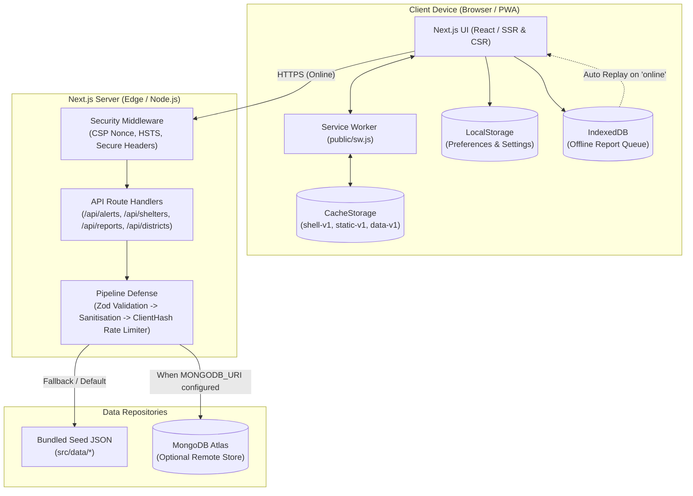

# Architecture Overview: Xahay (সহায়)

## 1. System Architecture Diagram

```
+---------------------------------------------------------------+
|                        User Device                            |
|                                                               |
|  +-----------------+     +-----------------------------+      |
|  |  Next.js UI     |<--->|  Service Worker (Cache)     |      |
|  |  (React, i18n)  |     |  app shell, guides, alerts  |      |
|  +--------+--------+     +--------------+--------------+      |
|           |                             |                     |
|  +--------v--------+            +-------v--------+            |
|  | LocalStorage /  |            | IndexedDB      |            |
|  | Preferences     |            | Report Queue   |            |
|  +-----------------+            +----------------+            |
+-----------------------------|---------------------------------+
                              | HTTPS (when online)
+-----------------------------v---------------------------------+
|                       Next.js Server                          |
|  /api/alerts   /api/districts   /api/shelters   /api/reports  |
|  validation (Zod) -> sanitising -> rate limit -> handler      |
+-----------------------------|---------------------------------+
                              |
                   +----------v-----------+
                   |  MongoDB Atlas       |
                   |  alerts, reports,    |
                   |  shelters, districts |
                   +----------------------+
```



---

## 2. Core Data Flows

### 2.1 Read Path (Guides, Helplines, Districts, Shell)

1. **Request**: UI initiates a resource fetch or navigation.
2. **Cache Interception**: The Service Worker intercepts the request.
3. **Cache-First Lookup**:
   - Next.js immutable static assets (`/_next/static/*`) and shell routes (`/{locale}/`, emergency numbers, guides) are served directly from `CacheStorage` (`static-v1` and `shell-v1`).
   - If not in cache, the network request is performed, cached for future visits, and returned.
4. **Offline Fallback**: If the network is unavailable and the requested navigation was not previously cached, the Service Worker serves `/offline.html`, providing instant access to emergency calling numbers (112, 108, 101, 1070) with zero external dependencies.

### 2.2 Alert Path (Stale-While-Revalidate)

1. **Immediate Cache Delivery**: When the user requests `/api/alerts` or visits the district alerts view, the Service Worker immediately serves the cached response from `data-v1` without waiting for network response.
2. **Background Revalidation**: In parallel, an asynchronous network request is dispatched to `GET /api/alerts`.
3. **Silent Update**: Upon receiving fresh data from the server, the cache is updated. If the alert level has changed, the UI seamlessly updates while displaying the exact timestamp when information was last refreshed.
4. **Honest Source Attribution**: Every alert displays its verified authority source (e.g., ASDMA, CWC, IMD) and last-updated timestamp; unverified demo data is explicitly flagged with `isDemo: true`.

### 2.3 Report Path (Community Incident Reporting)

1. **Client-Side Validation**:
   - The user fills out the incident report form (`ReportForm.tsx`).
   - Input is validated against client schemas (condition type, affected district, note length 1–200 characters, optional place $\le$ 80 characters).
   - Honeypot trap ensures automated spam bots are dropped without network overhead.
   - PII filter warns and blocks submissions containing Indian phone numbers or email patterns.
2. **Online Submission**:
   - If `navigator.onLine === true`, `POST /api/reports` is dispatched via HTTPS.
   - The Next.js server validates the payload with Zod (`createReportSchema`).
   - Inputs are sanitised (HTML tags, script injection, control characters stripped).
   - Rate limiting checks the salted cryptographic hash (`clientHash`) of the client network signature (max 5 reports/hour).
   - The report is persisted with `status: "pending"` in the repository (MongoDB or in-memory seed).
   - The server responds with `201 Created` and a clear notice that reports undergo human moderation before public broadcast.
3. **Offline Submission (IndexedDB Queue)**:
   - If the user is offline during a disaster outage, the report is saved immediately into the client's local IndexedDB `reports_queue` store.
   - The UI displays an affirmative confirmation: _"Saved on your phone. It will be sent when you are online."_
   - When network connectivity resumes (`window.addEventListener('online')`), the queue processor automatically replays stored reports through the standard `POST /api/reports` pipeline.

---

## 3. Storage Architecture

| Storage Layer       | Location | Contents                                                                                                            | Eviction / Persistence                                |
| :------------------ | :------- | :------------------------------------------------------------------------------------------------------------------ | :---------------------------------------------------- |
| **LocalStorage**    | Client   | Selected district, preferred locale (`en`, `as`, `hi`), high contrast mode, text scale, emergency kit checked items | User-controlled, persistent across browser restarts   |
| **IndexedDB**       | Client   | `reports_queue` for untransmitted emergency field notes                                                             | Cleared on successful replay when online              |
| **CacheStorage**    | Client   | `shell-v1` (app shell, offline fallback), `static-v1` (hashed JS/CSS), `data-v1` (alerts, shelters)                 | Versioned; pruned on service worker `activate` event  |
| **In-Memory Store** | Server   | Seed alerts, districts, shelters, pending reports (default mode)                                                    | Process lifespan; zero external database dependencies |
| **MongoDB Atlas**   | Cloud    | Persistent collections: `alerts`, `reports`, `shelters`, `districts`                                                | Persistent, indexed on TTL, status, and district      |

---

## 4. Architectural Decision Records (ADRs)

Key architectural decisions are documented in detail within `docs/adr/`:

- [ADR 001: Next.js App Router as Core Framework](file:///f:/Xohayy/docs/adr/001-nextjs.md)
- [ADR 002: Static Seed Data for Offline Availability](file:///f:/Xohayy/docs/adr/002-static-seed-data.md)
- [ADR 003: Service Worker Caching Strategy for Offline-First Resilience](file:///f:/Xohayy/docs/adr/003-caching-strategy.md)
- [ADR 004: No Public User Accounts for Data Minimization](file:///f:/Xohayy/docs/adr/004-no-public-accounts.md)
- [ADR 005: Pre-Publication Moderation for Community Ground Reports](file:///f:/Xohayy/docs/adr/005-moderation.md)
- [ADR 006: Dictionary-Based Internationalization (i18n)](file:///f:/Xohayy/docs/adr/006-dictionary-i18n.md)
